# LR6
Лабораторная работа №6
# Лабораторная работа №6. Система контроля версий Git

## 1. Цель работы
Изучение базовых возможностей системы управления версиями, опыт работы с Git Api, опыт работы с локальным и удаленным репозиторием.

## 2. Описание предметной области
Для выполнения лабораторной работы необходимо:
1. Создать аккаунт на сайте GitHub.
2. Сделать копию в личное хранилище из https://github.com/Kurtyanik/LR6/ (Fork).
3. Установить Git (https://git-scm.com/).
4. После установки настроить клиент git, введя имя пользователя (Группа Фамилия И.О.) и email.
5. Клонировать свой личный удалённый репозиторий на компьютер.
6. Добавить файл через интерфейс GitHub. Подтянуть изменения в локальный репозиторий. Работу продолжать локально.
7. Получить историю операций для каждой из веток.
8. Просмотреть последние изменения.
9. Выполнить слияние в ветку master, разрешив конфликт.
10. Удалить побочную ветку после успешного слияния.
11. Сделать изменения и зафиксировать их, оставляя комментарии, несколько раз.
12. Сделать откат коммита.
13. Создать ветку для отчёта.
14. Начать оформлять отчёт в файле README.md.
15. Получить историю операций в форматированном виде.
16. Отправить локальные изменения в сетевое хранилище GitHub.

## 3. Практическая часть

Сначала на уже существующий аккаунт на GitHub был добавлен репозиторий по ссылке в задании (рис. 1).

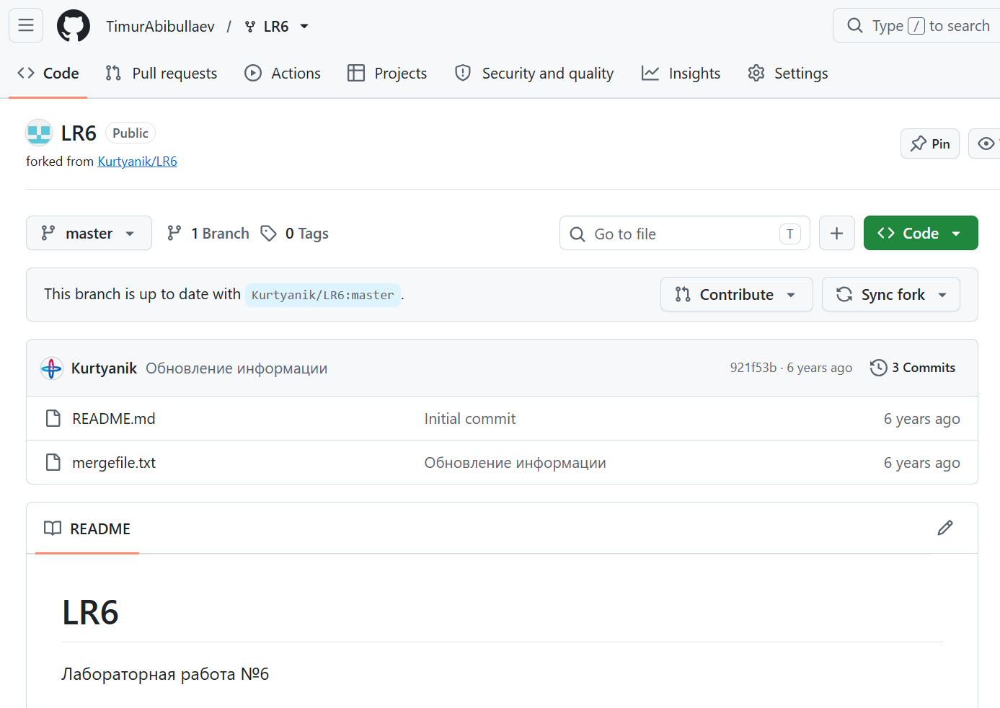

Далее был настроен клиент git (рис. 2).

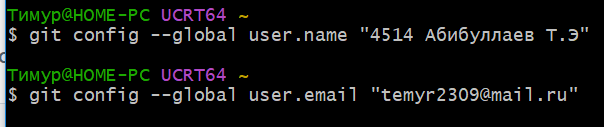

После этого удаленный репозиторий был клонирован на ПК (рис. 3).

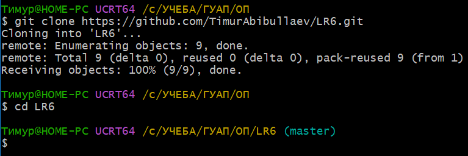

Затем в репозитории на GitHub был создан файл «new» (рис. 4), затем с помощью команды `git pull` этот же файл появился и на ПК (рис. 5).

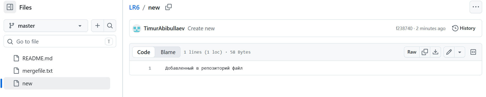

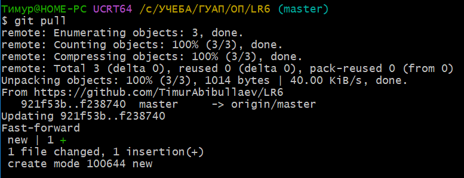

Полученный файл отобразился в папке, где хранится репозиторий, что свидетельствует об успешном выполнении операции (рис. 6).

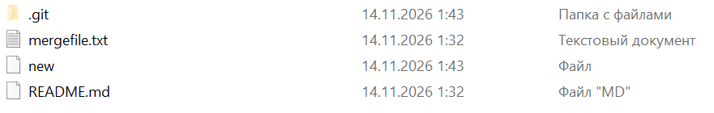

Затем была просмотрена история операций для каждой из веток, в данном случае ветка только одна (рис. 7).

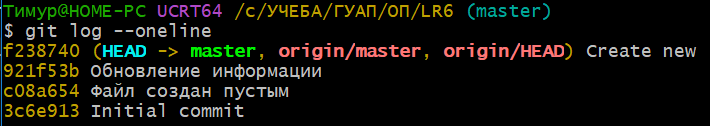

Потом были просмотрены последние изменения (рис. 8).

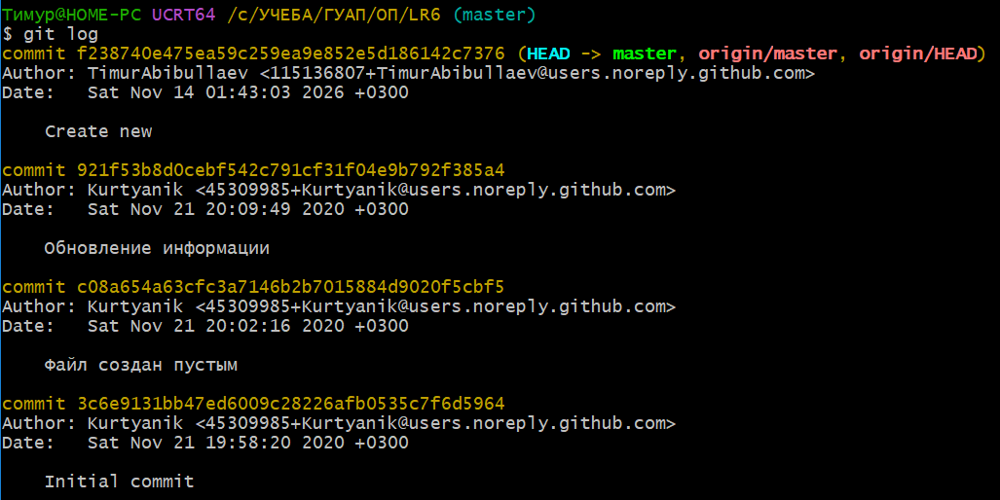

Следующим по заданию пунктом нужно выполнить слияние веток с разрешением конфликта. Для этого необходимо создать вторую ветвь, затем переключиться на нее и изменить файлы, в данной работе изменяться будет файл «mergefile» (рис. 9). Текст был также изменен и в главной ветви, а затем, когда поступила команда на их слияние, произошел конфликт (рис. 10).

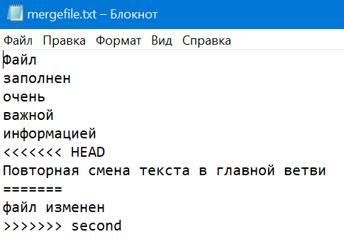

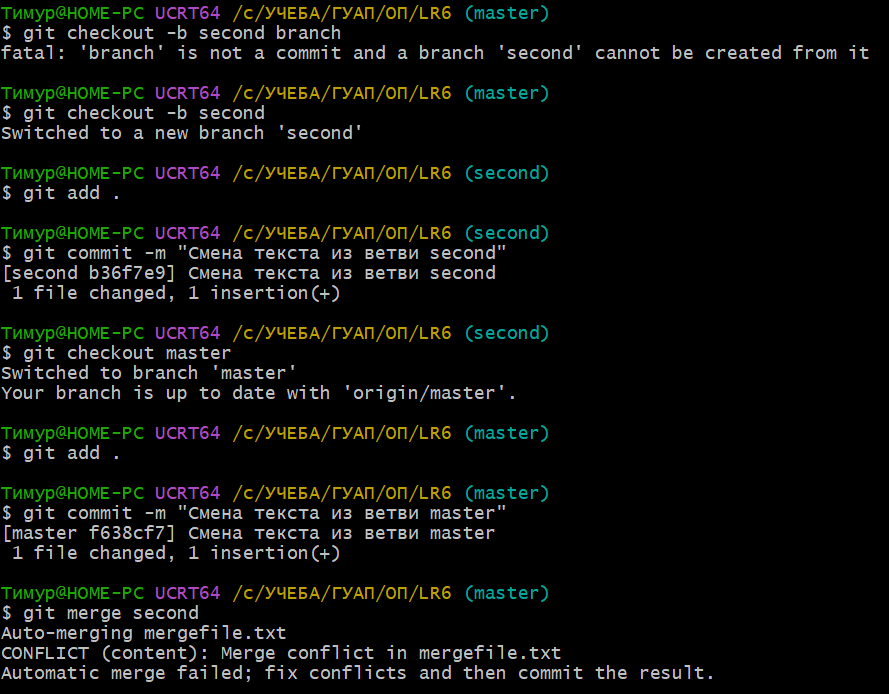

Для решения конфликта достаточно удалить маркеры с рисунка 9 и оставить либо одну, либо обе строки добавленного текста (рис. 11), тогда слияние произойдет без конфликтов (рис. 12).

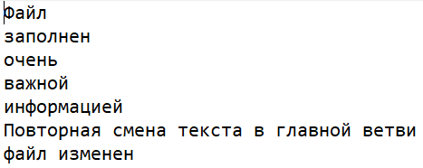

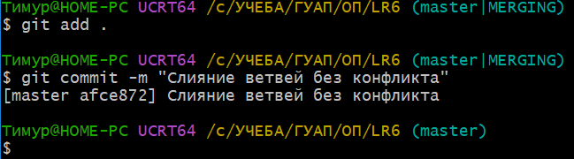

После слияния, ветка `second` была удалена (рис. 13).

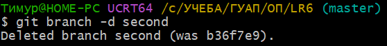

Следующим этапом в работе является создание коммитов и их откат. Для наглядности первым коммитом был создан файл «test», вторым коммитом стало создание текста внутри файла (рис. 14).

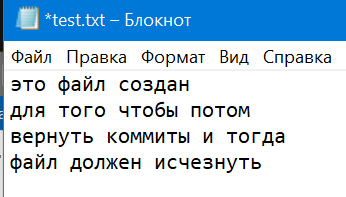

Сначала был добавлен файл (рис. 15), затем текст внутри него, эти два коммита представлены в консоли, чтобы было наглядно видно, что именно будет откатано обратно (рис. 16).

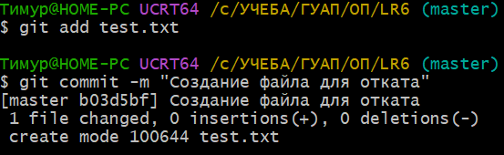

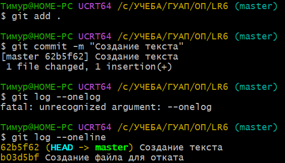

Далее был произведен откат последних двух коммитов (рис. 17). Как видно коммиты откатились, однако так как мы использовали soft reset, то файл новый остался, но как не отслеживаемый, то есть задание выполнено.

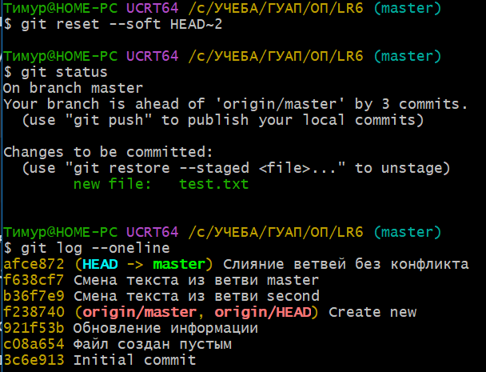

Потом была создана ветвь для отчета (рис. 18).

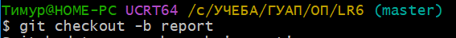

После этого была получена историю операций (рис.19)

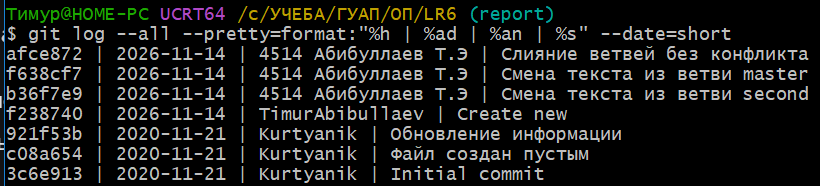

## 4. Лог выполненных команд

В ходе выполнения лабораторной работы были использованы следующие команды (без вывода результатов):

```
bash
# Настройка клиента
git config --global user.name "4514 Абибуллаев Т.Э"
git config --global user.email "temyr2309@mail.ru"

# Клонирование и синхронизация
git clone https://github.com/TimurAbibullaev/LR6.git
git pull

# Просмотр истории и изменений
git log --oneline
git status
git diff

# Работа с ветками и слияние
git checkout -b second
git checkout master
git merge second
git branch -d second

# Создание коммитов и откат
git add test
git commit -m "Создание файла для отката"
git add test
git commit -m "Создание текста"
git reset --soft HEAD~2

# Создание ветки для отчета
git checkout -b report

# История операций
git log --all --pretty=format:"%h | %ad | %an | %s" --date=short
```